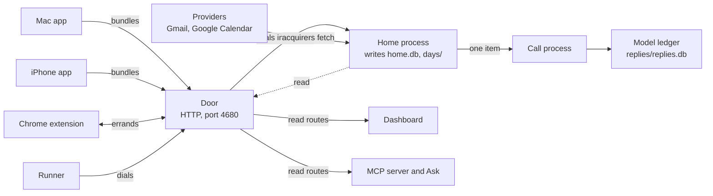

# Architecture

Lifestream is one process that keeps a life, the home, and the programs around it. Devices and
providers hand the home data. The home keeps all of it, derives what it can with code, asks a model
about single items, and writes one file for each day. Readers, such as the dashboard and the MCP
server, read the result through one HTTP process, the door.

This page names each part, what it owns and what it imports, and follows one WhatsApp message from
the Mac to a day file and to an answer in Chat. [The code's words](./code-words.md) defines each
term it uses, such as delivery, record and extract.

## The parts



**The home process** is the only program that writes `home.db`, the one SQLite file that holds
every record. It runs a loop of jobs: import a delivery, build a family's extracts, plan and send
model asks, render the days. **The door** is a separate HTTP process. Devices send it bundles, and
it seals each one into the folder `inbox/` as a delivery. Readers ask it for records, extracts,
days and search, and it reads them from `home.db` without writing. A page of an app reads one
**page answer**, in which the home has worked out what the page says, and the app lays it out. The home and the door start
and stop on their own, so a device can still send while the home is busy or restarting.

A model is reached through a **call process**, one for each request, which writes its reply to the
model ledger. The ledger is the home's second authority beside the blobs: it is never rebuilt, so
an input that was answered once is never paid for again.

## The packages

The TypeScript code is seven packages under `packages/`. Imports point down the table, and two
packages in one row never import each other. `tools/check-layers.ts` refuses any other import, and
`npm run check` runs it.

| Package | What it owns | Imports |
|---|---|---|
| [core](../../packages/core/) | The record format, time, `home.db` and every transaction on it, the blob store, secrets | nothing of ours |
| [connect](../../packages/connect/) | Connectors: the acquirers that fetch from providers, the readers that read deliveries into rows, the labelers | core |
| [families](../../packages/families/) | The families that turn records into extracts and asks, and the render of the day file | core; its tests connect too |
| [model](../../packages/model/) | The model ledger, the asker, the transports that reach a model, the call process | core |
| [privacy](../../packages/privacy/) | Who marks what in a text that leaves, and the one function that hides it | core |
| [home](../../packages/home/) | The home process and its jobs, the door, the `lifestream` command, releases | core, connect, families, model, privacy |
| [runner](../../packages/runner/) | The runner, which runs model files on the person's own machine for the home | core, model |

Families are pure: they read a view of `home.db` and return values, and the home writes them.
Readers and acquirers write nothing either: the home seals what an acquirer fetches and lands
what a reader reads. `tools/check-layers.ts` holds the layers: imports point down the table above,
never up or sideways.

## The apps and the readers

The other folders sit outside the import graph. A device reaches the home only by sending to the
door, and a reader reads only through the door's read routes.

- [The Mac app](../../macos-app/) (`macos-app/`, Swift) records the screen, input, audio
  and machine events, reads other apps' stores such as WhatsApp's, and sends bundles to the door.
  It also carries a release, sets up the home, runs the home's programs as launchd agents, and
  shows the dashboard in its window.
- [The iPhone app](../../ios-app/) (`ios-app/`, Swift) records location, motion, photos,
  voice notes and more, and sends bundles to the door.
- [HomeLink](../../homelink/) (`homelink/`) is the Swift package both apps use to reach
  the home: pairing, the exchange with the door, sending a bundle. Both apps read the photo library
  with [PhotoLibrary](../../photolibrary/) (`photolibrary/`). In the Mac app,
  [DeviceFiles](../../devicefiles/) (`devicefiles/`) is the only code that touches the
  bytes of a file the app keeps, encrypted or not.
- [The Chrome extension](../../extension/) (`extension/`) makes a Chrome profile a
  station: the door hands it errands, such as reading a site with the person's own sign-in.
- [The dashboard](../../dashboard/) (`dashboard/`) is the web app the Mac window shows:
  Chat, Timeline, People, Places, Connectors and Agents. Its server reads the door and imports no
  package.
- [The MCP server](../../mcp/) (`mcp/`) serves the door's read routes as tools to an
  agent, and answers Chat with a model that uses the same tools.
- [face-engine](../../faces/) (`faces/`) is the Swift program the faces labeler runs.
- [Lifestream Cockpit](../../design/) (`design/`) is the design system the apps and the
  dashboard draw with.

## One message, from the Mac to a day

Say a friend sends a WhatsApp message with a photo, and the person reads it on their Mac.

**The Mac sends it.** The Mac app reads WhatsApp's database on the Mac, which it can open with
Full Disk Access. On each run it asks the door how far the home has taken each source
(`POST /v1/exchange`). It then seals what changed in the database, and the photo, into a bundle,
and sends it through HomeLink (`PUT /v1/acquisitions/<source>/<fetched-at>`). The source is
`whatsapp:<phone>:<unit>`: this account's WhatsApp, as this Mac holds it.

**The door keeps it.** The door seals the bundle into `inbox/` as a delivery and nudges the home
over its socket, `run/<name>.sock` in the machine directory. From now on the files never change, so a later release can read the
delivery again.

**The home lands it.** The commit that notes the new delivery queues the job
`import <source>`. A helper thread runs the WhatsApp reader, `whatsapp-db` in
`packages/connect/messages/whatsapp/`, which yields one row for each message, chat and call. The
home's main thread lands the rows as statements in one transaction: the new message becomes a
record, and its content becomes the record's head. Its photo is a blob, named by its SHA-256.

**The family builds the day.** The same commit makes the messages family's work due. The family
writes the extract for this chat on this day again, but only when what it read has changed. The job
`render days` then writes the day's files under `days/`. The day file now holds a line such as
`07:12 Person A: message 157 [photo]`.

**A model reads the photo.** The messages family asks for a caption of each photo it shows, once
the home holds the photo's bytes. The job `plan messages` writes the ask. The job
`send messages` sends it by the route the connector's settings choose, writes the request to the
ledger, and starts a call process. When the reply is in the ledger, the home writes it as an
enrichment and renders the day again: the line now ends `[photo: …]` with the caption. Every
step appends an event to the door's feed, so the dashboard shows the change at once.

The other connectors follow the same path. A provider such as Gmail differs only at the start: an
acquirer in the home fetches the mail, and the home seals it as a delivery itself.

## One question, in Chat

The person asks Chat in the Mac window: "What did my friend send me this morning?"

The dashboard's server passes the question to the door (`POST /v1/ask`), and the door passes it
on to the Ask server, which is the MCP server on port 4681. The home itself never calls a model
for Chat. The Ask server gives the question to a model through the person's choice: their Claude
or ChatGPT plan, or an OpenRouter key. The model calls the same tools an agent gets, such as
`search` and `read`, and each tool reads one of the door's read routes, such as `/v1/search` and
`/v1/read`. The answer cites the items it used, so the person can follow it back to the message.

When the answer ends, the Ask server sends the turn to the door as a delivery of the owner source
`ask:local:<home>`. The home lands it as it lands any delivery, so the conversation is part of the
record too. The iPhone app's Chat takes the same path through the door.

## The rules the home keeps

Each rule is enforced by code or by a named test.

- **Two authorities.** The blobs and the model ledger are never rebuilt. Everything else
  (extracts, enrichments, day files, the job queue) can be rebuilt by a command.
- **Identity is content.** A version's id is the SHA-256 of its canonical JSON. The same message
  stated by the Mac and the phone is one version.
- **The newest statement wins, and nothing is lost.** An older backup arriving late is recorded
  and changes nothing. A deletion is a statement too.
- **Nothing is predicted.** A connector copies what the source states, every field, and a record
  missing from a delivery is never treated as deleted.
- **Derived work is keyed on what it read.** A nightly snapshot that restates 122,000 rows costs a
  re-read and writes nothing.
- **Pay per item, never per period.** No model summarises a day or a chat; it describes one photo
  or one voice note, cached by its exact input.
- **Ingestion never waits for a person.** There are no holds and no approvals. Every change can be
  undone, and paid work has a daily budget it cannot pass.
- **Owner deletion is absolute, with stated limits.** `erase` removes a thing from every table,
  replica, enrichment, ledger row and day file, and refuses it forever.
- **Boring parts.** One SQLite file, Node's built-in crypto and zstd, and canonical JSON
  (RFC 8785). Nothing is hand-built where a standard part exists.

## The repository

Each folder has its own README, linked from [The packages](#the-packages) and
[The apps and the readers](#the-apps-and-the-readers).

```
packages/
  core/       the format, time, the home database, blobs, secrets    imports nothing of ours
  connect/    acquirers, connectors and labelers, by category        imports core
  families/   records → extracts → day lines; the day file           imports core
  model/      the model ledger, the asker, transports, call process  imports core
  privacy/    what is hidden in a text that leaves the Mac            imports core
  home/       the home process, the door, the CLI, releases          imports all five
  runner/     model files run on another machine for the home        imports core, model
bin/          lifestream, the command that runs the home's verbs
macos-app/    the Mac app: setup, recorders, shipping, the window (Swift)
ios-app/      the iPhone app (Swift)
homelink/     how a device pairs with and sends to its home (Swift)
photolibrary/ how a device reads its photo library (Swift)
devicefiles/  the only code that touches the bytes of a file the Mac app keeps (Swift)
faces/        face-engine, the program the faces labeler runs (Swift)
dashboard/    the Lifestream window: a local web app over the home's read routes
mcp/          the MCP server: the home's read routes as tools for an agent
extension/    the Chrome extension
design/       the design system: tokens, icons, the Swift and web kits
docs/         the docs for people who use Lifestream and for contributors
tools/        the checks, the test lock and the generators
testing/      the test harness: each run's setup, the quarantined and Mac-only tests
worker/       the server that keeps the reports people send from the apps
```

The door's routes are `packages/home/door.ts`'s. Device enrollment, repair, undo, erasure and every
other verb print their usage with `bin/lifestream help <verb>`.

## Where each question is answered

Each part keeps its own pages. These tables say which page answers a question, so you open one
page, not the whole folder.

### The home

| Question | Document |
|---|---|
| The code's words | [code-words.md](./code-words.md) |
| How to run a home from a checkout: start, status, the verbs | [develop.md](./develop.md#run-a-home-from-your-checkout), and `bin/lifestream help <verb>` |
| What one connector reads, its kinds and keys | its page, listed in [the connector guide](../../packages/connect/SKILL.md#every-connectors-page) |
| What a family asks a model | its prompts, in `packages/families/<family>/prompts/`, with the parts they share in [covered.md](../../packages/families/shared/prompt-parts/covered.md) and [placeholders.md](../../packages/families/shared/prompt-parts/placeholders.md) |
| The day file's shape | [the day file](../user/day-file.md) |
| The places and time zones the home names, and where they come from | [geography/](../../packages/families/shared/geography/) |
| What an agent is told about the tools | [mcp/SKILL.md](../../mcp/SKILL.md) |

### The devices and the wire

| Question | Document |
|---|---|
| Uninstalling: the person's steps on the Mac, the extension and the iPhone | [user/uninstall.md](../user/uninstall.md) |
| The phone capture app, its contacts, named places and check-ins | [ios-app/](../../ios-app/) |
| The Mac app: the screen, the input log, the recording modes, the device lines and audio, shipping, the dashboard window and its host contract, what it costs the Mac | [macos-app/](../../macos-app/) |
| How the Mac app keeps its own files, plain or encrypted with a key of the Mac's: the one module that writes and reads them, and its layouts | [devicefiles/](../../devicefiles/) |
| The dashboard: the local web app over the door's read routes | [dashboard/](../../dashboard/) |
| The Chrome extension: errands in the person's own browser, and the station wire | [extension/](../../extension/) |
| Faces: the labeler, its records and erasures, the owner's naming | [faces.md](../../packages/connect/labelers/faces/faces.md); the naming view: [dashboard/](../../dashboard/); the engine: [faces/](../../faces/), and its models' licences: [MODEL-NOTICES.md](../../faces/MODEL-NOTICES.md) |

### The docs

A page lives only where `PLACES` in `tools/check-docs.ts` says.

## Next

- [Set up to develop](./develop.md): build and run Lifestream from a checkout.
- [The code's words](./code-words.md): the words the code uses, and what each means.
- [Add a connector](../../packages/connect/SKILL.md): bring a new source into the home.
