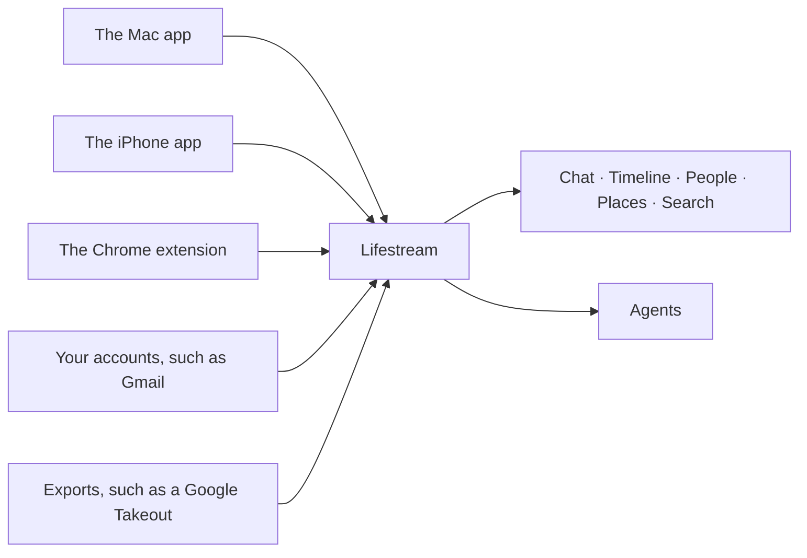

# How Lifestream works

Lifestream gathers what your devices and accounts know about your days into one folder on your
Mac. From that folder it lays out each day of your life on Timeline, answers your questions in
Chat, and shows the people you were with and the places you went. The folder stays on your Mac.
Only the AI models and agents you choose read parts of it.

## What feeds Lifestream

Each kind of data Lifestream brings in is a connector: Gmail is one, Photos is another. A connector
reaches Lifestream in one of five ways:

- **The Mac app** records your screen, your keys and clicks, and audio. It also reads apps on your
  Mac, such as your messages, notes, calls, photos and browser history.
- **The iPhone app** records where you go and how you move. It also reads your health, photos,
  contacts and more. It sends what it records to Lifestream over your Wi-Fi, or through Tailscale
  when you are away. See [Pair your iPhone](./pair-your-iphone.md).
- **The Chrome extension** reads some sites in your own Chrome, with the sign-ins Chrome already
  has, such as WHOOP, ChatGPT and Claude.
- **Your accounts.** Lifestream signs in to some accounts itself, such as Gmail, Google Calendar
  and GitHub, and checks them for new data.
- **Exports.** An export is a file a company makes of your data when you ask for it, such as a
  Google Takeout. See [Bring in your past from an export](./imports.md).

Every connector brings in new data from now on, and your past at the same time, newest first. You
add, pause and disconnect connectors on [Connectors](./connectors/README.md).

## Lifestream keeps everything

Everything Lifestream gathers goes into its folder, on your Mac or on an external drive you choose:
your messages, emails, photos, places, health, and what was on your screen.

Lifestream keeps each thing as it came in, and never writes over it. If a contact or an email
changes later, Lifestream keeps the old version as well as the new one. If you disconnect a
connector, everything it brought in stays. [Lifestream's folder and its disk](./your-home.md) says
where the folder lives and how fast it grows.

## How a day is made

Lifestream puts what every connector brought in for a day in order. The spine of the day is where
you were: each place you stayed, and each move between places. Inside each stay is what happened
there, such as your messages, calls, emails, photos and time at the Mac. [Timeline](./timeline.md)
shows a day this way.

Some parts of a day need an AI model to read them. A model describes a photo, writes out a voice
note, sums up a stretch of time at your screen, or writes one line about an automated email. Each
connector's window says what a model does with it, under **AI**. You choose the model, or turn it
off, as [Connectors](./connectors/README.md#settings-every-connector-has) explains.

## Where you see your life

- **[Timeline](./timeline.md)** shows one day at a time: where you were, and what happened there.
- **[Chat](./chat.md)** answers questions about your life, and cites the messages, emails and
  photos it used.
- **[Search](./search.md)** finds any message, page or note by its words. On the Mac it is the
  **Search** row at the top of the sidebar, or ⌘K.
- **People** lists the people in your life, each one joined across your messages, email, contacts
  and photos. **Most in touch** shows the people you message most. A person's page shows how much
  you talk, week by week, where you talk, their photos, and the numbers and emails that are theirs.
  When Lifestream is not sure two are the same person, it asks you. See
  [Name the people in your photos](./name-people.md).
- **Places** shows the places you go on a map, from your iPhone's location, your photos and
  [Google Maps Timeline](./connectors/google-timeline.md). Its three lists are **Places**,
  **Cities** and **Trips**. A trip appears when you spend a night away from home. A place's page
  shows your visits there, the people you were with, and your photos. See
  [Name your places](./name-your-places.md).

[The iPhone app](./iphone-app.md) has the same Chat, Timeline, People, Places and Search, and reads
them from Lifestream on your Mac. You can also let an agent, such as Claude or ChatGPT, read
Lifestream: see [Connect an agent](./connect-an-agent.md).

## What stays on your Mac

Lifestream's folder stays on your Mac, or on the drive you chose. Lifestream makes no copy of it
anywhere else.

Some work goes to an AI model that you choose: your ChatGPT or Claude plan, a key you add, or a
model that runs on your Mac. When the model runs somewhere else, what it reads goes to the company
that runs it. Lifestream hides your personal details first, unless you turn that off.
[What leaves your Mac](./what-leaves-your-mac.md) says what goes where, and how to stop it.

## Next

- [Quick start](./quick-start.md), to set up Lifestream.
- [What leaves your Mac](./what-leaves-your-mac.md), to see what goes to a model.
- [Timeline](./timeline.md), to read a day.
